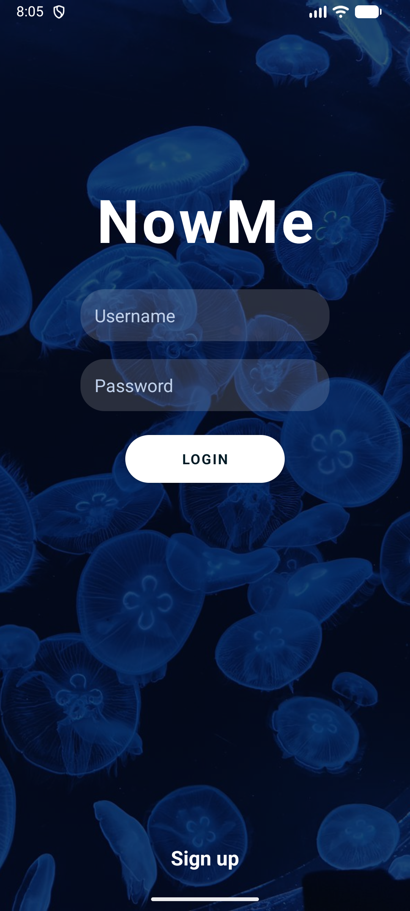
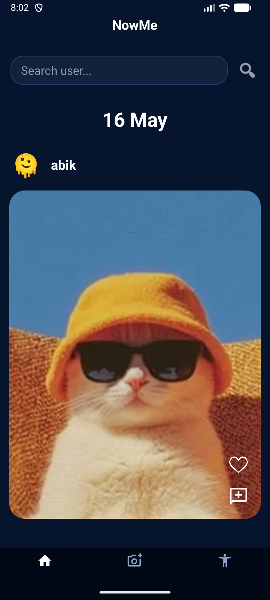
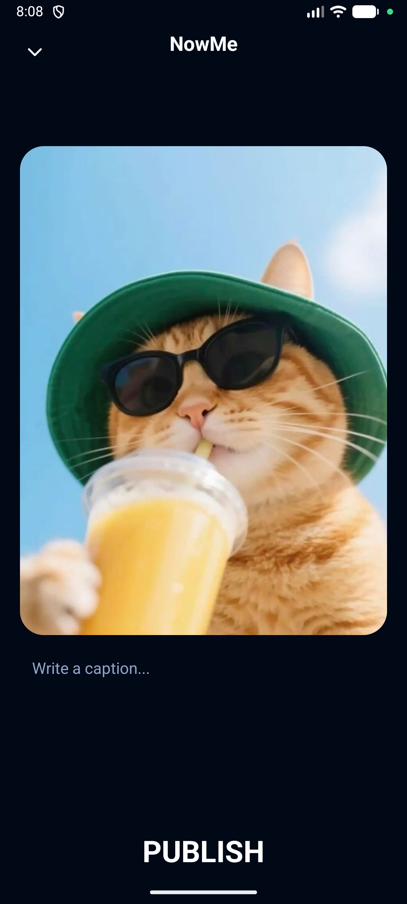
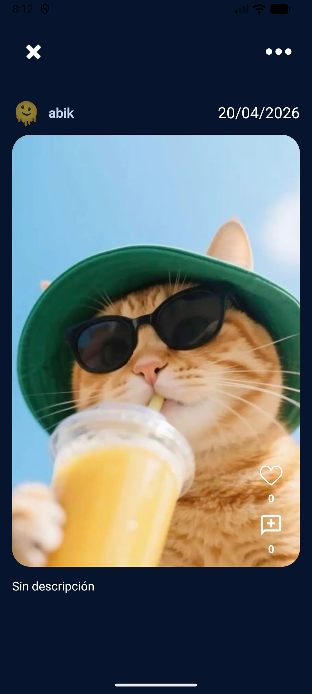
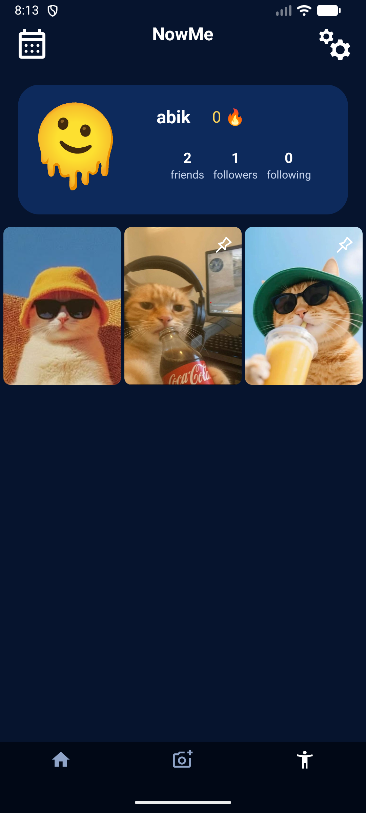
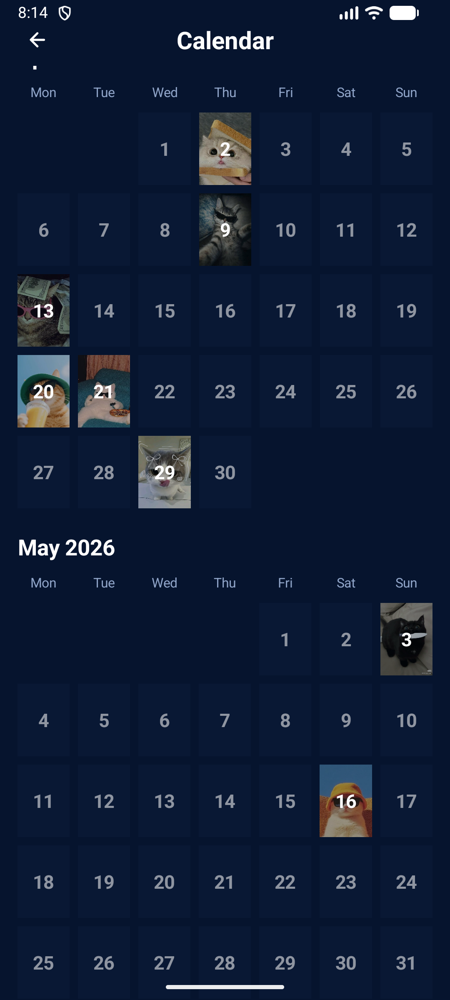

# NowMe

**NowMe** is a daily photo-sharing application inspired by the real app BeReal. The idea is to motivate users to take a photo every day, so they can follow the story of their own life, keep warm memories, and also see everyday moments from their friends' lives.

The project was developed jointly by two students as their final project. It is split into two connected parts: an Android application for the user experience and a Spring backend for authentication, data storage, images, and social features.

# NowMe Android

NowMe Android is the mobile client for this system. It is the part users touch: they sign in, take photos, publish NowMe posts, browse the feed, open profiles, follow friends, leave likes, write comments, and look back through their personal history.

The app is not a static prototype. It talks to a real backend API, stores authentication tokens, uploads photos, loads images from the server, and keeps the main social actions synchronized with the backend.

## Project Pair

- [**NowMe Android**](https://github.com/abi4ka/NowMe-Android): the mobile app in this repository.
- [**NowMe Spring**](https://github.com/abi4ka/NowMe-Spring): the backend REST API used by the Android app.

By default, the app connects to the local backend at:

```text
http://10.0.2.2:25565/
```

This address is used for the Android emulator to reach the Spring server running on the development machine.

## Screenshots

<table>
  <tr>
    <td></td>
    <td></td>
    <td></td>
  </tr>
  <tr>
    <td></td>
    <td></td>
    <td></td>
  </tr>
</table>

## Features

- User registration and login.
- Access and refresh token storage.
- Automatic token refresh through OkHttp authentication.
- Main feed with recent NowMe posts.
- Pull-to-refresh support.
- User search.
- User profiles with follower and following counts.
- Follow and unfollow actions.
- Camera capture with CameraX.
- Image publishing with optional description.
- Server-loaded post images.
- Likes and unlikes.
- Comments list and comment creation.
- Favorite toggle for posts.
- Post visibility update.
- Own post deletion.
- Personal NowMe history.
- Calendar-style history view.
- Local UI state stores for likes, comments, feed invalidation, and image caching.

## Tech Stack

- Java 11 source compatibility.
- Android SDK 36.
- Minimum SDK 32.
- AndroidX AppCompat.
- Material Components.
- ConstraintLayout.
- Android Navigation.
- SwipeRefreshLayout.
- CameraX.
- Retrofit 3.
- Gson converter.
- OkHttp logging interceptor.

## How It Works

1. The user signs in or creates an account.
2. The backend returns access and refresh tokens.
3. The Android app stores tokens locally and attaches the access token to protected API requests.
4. If the access token expires, the authenticator calls the refresh endpoint and retries the request.
5. The user can browse the feed, search for people, follow profiles, publish photos, like posts, and comment.
6. Images are uploaded as multipart form data and later loaded from the backend image endpoint.

## Running Locally

1. Start the [NowMe Spring](https://github.com/abi4ka/NowMe-Spring) server.
2. Open `NowMe/` in Android Studio.
3. Build and run the app on an emulator or device.
4. If you use an emulator, keep the default backend URL:

```text
http://10.0.2.2:25565/
```

For a physical Android device, replace the base URL in `RetrofitClient.java` with the development machine IP address reachable from the device.
